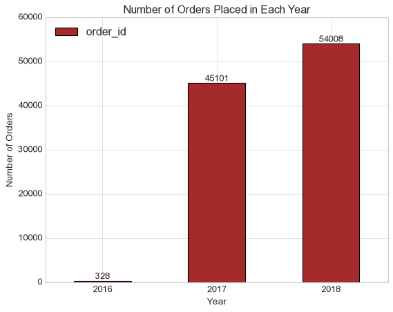
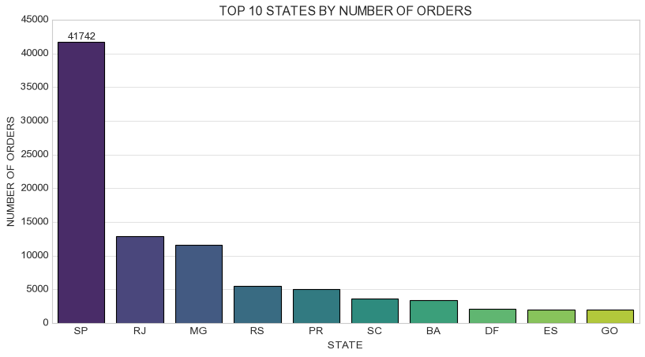
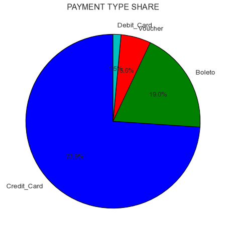
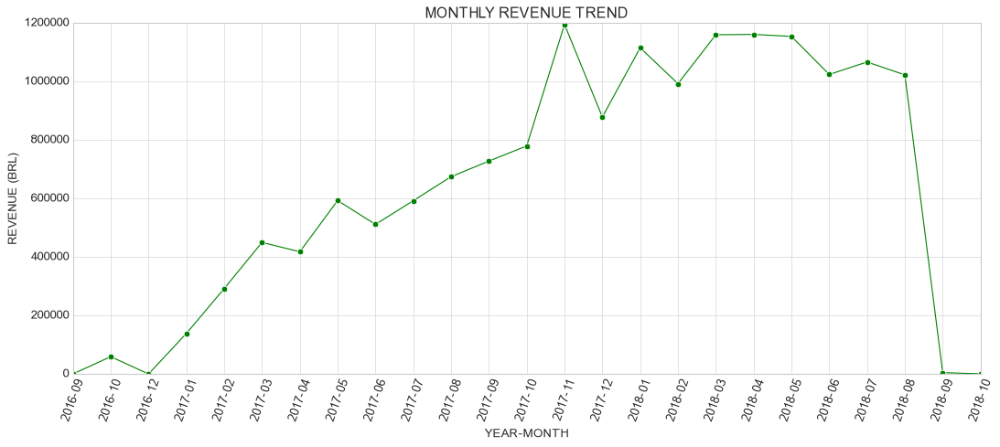
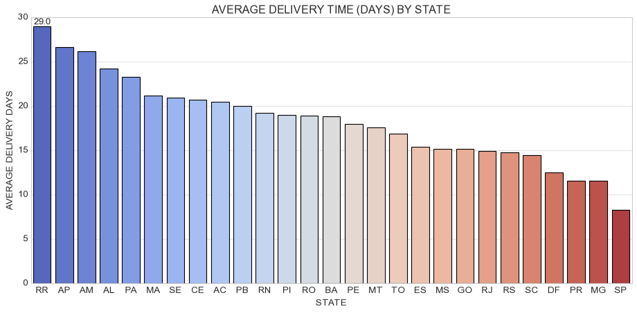
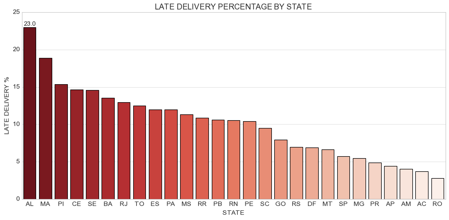
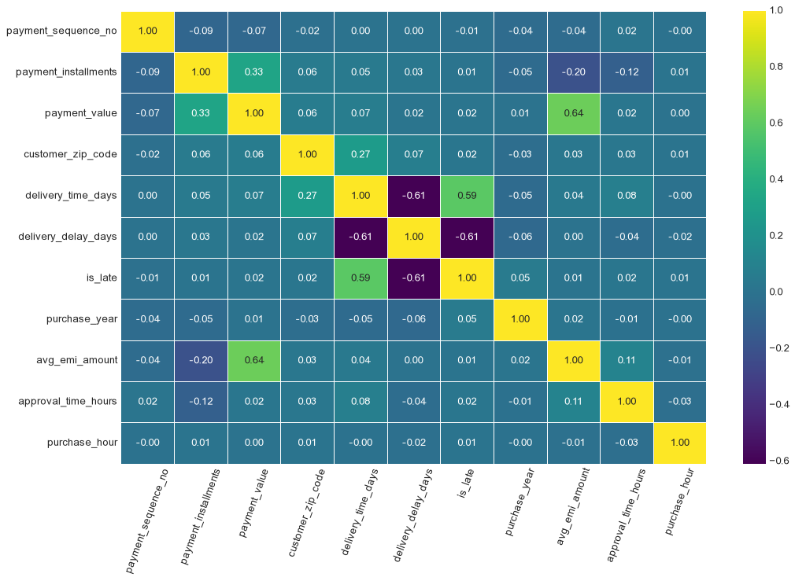
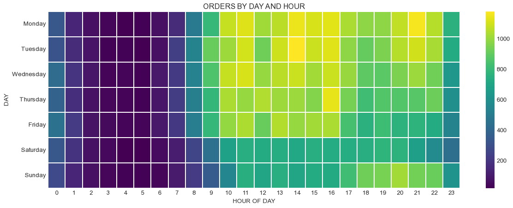

# 🛒 Olist Brazilian E-Commerce: Exploratory Data Analysis


An end-to-end Exploratory Data Analysis (EDA) project on the Brazilian E-Commerce (Olist) dataset. The project covers data merging, cleaning, feature engineering and visual analysis of sales growth, payment behaviour, delivery performance and customer retention.

---

## 📌 Table of Contents
- [Project Overview](#-project-overview)
- [Dataset](#-dataset)
- [Project Workflow](#-project-workflow)
- [Feature Engineering](#-feature-engineering)
- [Key Insights](#-key-insights)
- [Visualizations](#-visualizations)
- [Recommendations](#-recommendations)
- [Repository Structure](#-repository-structure)
- [How to Run](#-how-to-run)
- [Author](#-author)

---

## 🎯 Project Overview

Olist is a Brazilian e-commerce marketplace. The goal of this project is to turn raw transactional data into clear findings that answer questions like:

- How has the business grown over time?
- Which states and cities generate the most orders?
- Which payment methods do customers prefer?
- How good is the delivery performance, and where are the bottlenecks?
- Do customers come back to place more orders?

---

## 📂 Dataset

**Source:** [Brazilian E-Commerce Public Dataset by Olist (Kaggle)](https://www.kaggle.com/datasets/olistbr/brazilian-ecommerce)

Three tables were used and merged on common keys:

| Table | Description | Joined On |
|---|---|---|
| `olist_orders_dataset.csv` | Order status and purchase/delivery timestamps | `customer_id` (with customers) |
| `olist_customers_dataset.csv` | Customer ID, city, state and zip code | `customer_id` |
| `olist_order_payments_dataset.csv` | Payment type, installments and payment value | `order_id` |

| Stage | Rows | Columns |
|---|---|---|
| After merging | 103,886 | 16 |
| After cleaning | 103,877 | 16 |
| After feature engineering | 103,877 | 27 |

> **Note:** The data is at the **payment level**, so one order can have more than one row. Order-level counts are calculated using unique `order_id`.

---

## 🔄 Project Workflow

### 1️⃣ Data Wrangling (`01_Brazilian_Olist_Data_Wrangling.ipynb`)
- Merged the three tables using inner joins.
- Converted all date columns to `datetime` format.
- Renamed columns for clarity and standardised text (title case) in categorical columns.
- Checked for duplicate rows (none found).
- Removed invalid records (`Not_Defined` payment type and payment value ≤ 0).
- Filled missing `order_approved_at` values using the purchase timestamp.
- Exported the cleaned dataset.

### 2️⃣ Exploratory Data Analysis (`02_Brazillian_Olist_Ecommerce_EDA.ipynb`)
- **Missing value analysis:** checked nulls and explained why delivery dates are missing (cancelled / not yet delivered orders).
- **Outlier detection:** used the IQR method. Outliers were kept because they are real high-value orders and real late deliveries.
- **Univariate analysis:** summary statistics (median, skewness, IQR), histograms, boxplots, top states and cities, order status and payment type share.
- **Time trend analysis:** orders by year, month, day of week and hour of day.
- **Bivariate analysis:** payment type vs value and installments, delivery time and late delivery by state and month, correlation heatmap.
- **Multivariate analysis:** month vs year and day vs hour heatmaps.
- **Business KPIs:** total revenue, average order value, late delivery rate, repeat customers, top states by revenue and monthly revenue trend.

---

## 🛠️ Feature Engineering

| Feature | Description |
|---|---|
| `delivery_time_days` | Days taken from purchase to delivery |
| `delivery_delay_days` | Estimated delivery date minus actual delivery date |
| `is_late` | 1 if delivered late, 0 if on time or early |
| `purchase_year`, `month`, `day`, `purchase_hour` | Time features from the purchase timestamp |
| `avg_emi_amount` | Payment value divided by number of installments |
| `approval_time_hours` | Hours between purchase and order approval |
| `year_month`, `payment_mode` | Monthly period and installment / one-time payment flag |

---

## 💡 Key Insights

- **The business is growing.** There were very few orders in 2016. In 2017 there were 47,520 payment records, and in 2018 it went up to 56,011.
- **Most orders come from a few states.** Sao Paulo (SP) is far ahead with about 41.7K orders, followed by Rio de Janeiro (RJ) and Minas Gerais (MG).
- **Credit Card is the most popular payment method.** About 74% of the payments are made by Credit Card. It is also the only method where people use installments (about 3.5 on average).
- **Voucher payments are much smaller.** Credit Card, Boleto and Debit Card payments average around 143 to 163 BRL, but Voucher payments average only about 66 BRL.
- **Most orders reach on time.** About 92% of the orders were delivered on time and only 8% were late. The average delivery time is about 12 days.
- **Remote states face long delivery times.** States like RR, AP and AM take 26 to 29 days on average. AL, MA and PI have the highest percentage of late deliveries.
- **Very few customers come back.** Out of about 96K unique customers, only about 3K ordered more than once (around 3%).

---

## 📊 Visualizations

| Orders per Year | Top 10 States by Orders |
|:---:|:---:|
|  |  |

| Payment Type Share | Monthly Revenue Trend |
|:---:|:---:|
|  |  |

| Average Delivery Time by State | Late Delivery % by State |
|:---:|:---:|
|  |  |

| Correlation Heatmap | Orders by Day and Hour |
|:---:|:---:|
|  |  |

---

## ✅ Recommendations

1. **Improve logistics in remote states** (RR, AP, AM, AL, MA, PI) with regional warehouses or better delivery partners, as they have the longest delivery times and the most late deliveries.
2. **Focus on customer retention** using discounts, loyalty rewards or follow-up offers, since only about 3% of customers place a second order.
3. **Plan for peak months** (such as November and March) by increasing logistics capacity, because late deliveries are higher in these months.
4. **Promote installment payments** on higher-value products, because installments are used only with Credit Card and are linked to larger payment values.

---

## 📁 Repository Structure

```
Olist-E-Commerce-Exploratory-Data-Analysis/
│
├── 01_Brazilian_Olist_Data_Wrangling.ipynb   # Merging and cleaning
├── 02_Brazillian_Olist_Ecommerce_EDA.ipynb   # Feature engineering and EDA
├── Brazillian_cleaned_olist_dataset.csv      # Cleaned dataset (output of notebook 01)
├── Brazillian_olist_final_eda_dataset.csv    # Final dataset with engineered features
├── olist_customers_dataset.csv               # Raw data
├── olist_orders_dataset.csv                  # Raw data
├── olist_order_payments_dataset.csv          # Raw data
├── Images/                                   # Charts used in this README
└── README.md
```
## 👤 Author

**Shrikant Pedde**
Undergraduate
Computer Science Engineering 


[](https://linkedin.com/in/shrikant-pedde-535624320)
[](https://github.com/shrikantpedde)
